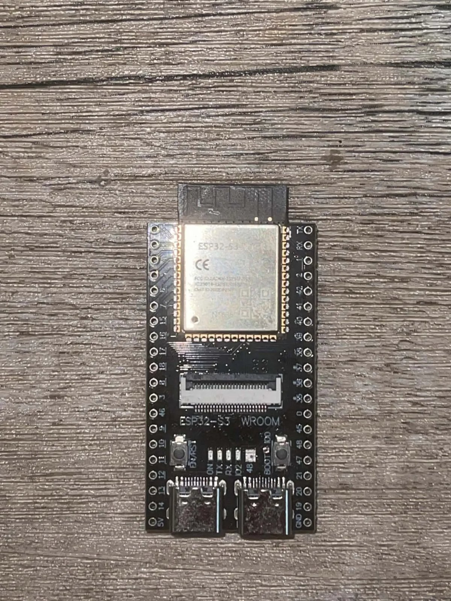
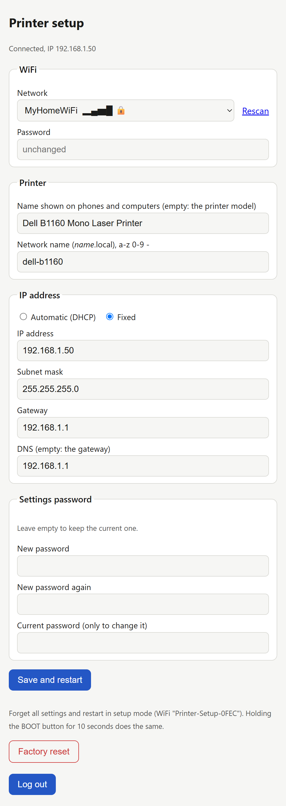
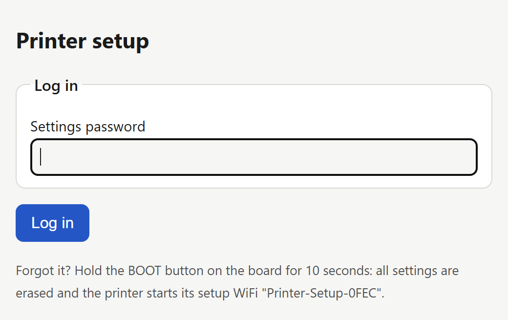
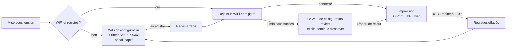

<div align="center">

# ESP32 USB → AirPrint

**Transformez une imprimante USB en imprimante sans fil AirPrint / IPP Everywhere avec une carte ESP32-S3 à une dizaine d'euros.**
Pas d'ordinateur, pas de serveur CUPS, pas de pilote à installer sur le téléphone.

[English](README.md) · [Tiếng Việt](README.vi.md) · **Français**

[](LICENSE)




</div>

> [!NOTE]
> Ceci est un fork de [ngxson/esp32-usb-to-airprint](https://github.com/ngxson/esp32-usb-to-airprint) (imprimantes et scanners Canon PIXMA). Il ajoute un **pilote pour les imprimantes laser Samsung / Dell SPL (QPDL v3)**, une **page de configuration web avec portail captif** (changer de WiFi sans recompiler) et la possibilité de **remplacer un serveur CUPS existant** sans toucher aux postes clients.

## Fonctionnalités

- **Imprimer** depuis iPhone, iPad et Mac (AirPrint), Android (Mopria), Windows et Linux (IPP Everywhere). Aucune application, aucun pilote.
- **Numériser** (multifonctions Canon) depuis un navigateur, Capture d'image / Aperçu sur Mac, ou avec le bouton de la carte.
- **Configuration depuis le téléphone.** Une carte neuve crée son propre WiFi `Printer-Setup-XXXX` ; connectez-vous et la page de configuration s'ouvre toute seule. Choisissez votre réseau dans la liste, c'est fini.
- **Page de configuration web** (`http://<nom>.local/setup`) : WiFi, nom de l'imprimante, nom réseau, **DHCP ou IP fixe**, mot de passe de la page, réinitialisation d'usine.
- **Jamais enfermé dehors :** le WiFi de configuration revient tout seul si le réseau enregistré reste injoignable 2 minutes, et **maintenir BOOT 10 s** efface tous les réglages.
- **Remplacement direct de CUPS :** la carte répond sur `/ipp/print` et sur les URL de style CUPS `/printers/<file>`, donc les postes configurés pour l'ancien serveur continuent d'imprimer quand la carte reprend son adresse IP.
- **Une application web** sur téléphone ou ordinateur : imprimer des PDF et des images, numériser, garder les fichiers dans le navigateur, assembler des pages (rotation, recadrage, copie de carte d'identité) en PDF.

## Imprimantes prises en charge

| Famille | Modèles | État | Scanner |
|---|---|---|---|
| **Samsung / Dell SPL (QPDL v3)** | **Dell B1160** | 🟢 testé : A4 1200 dpi, AirPrint depuis iPhone | pas de scanner |
| Samsung / Dell SPL (QPDL v3) | Samsung ML-2160 / ML-2165 / ML-2168, Dell B1160w (USB) | 🟡 même langage, pas encore testé | – |
| Canon PIXMA | MG2550S | 🟢 testé (projet d'origine) | oui |
| Canon PIXMA | MG2400, MG2500, MG2900, MG3000, E460/E470, E3100, TS3100, MP230, MP250–MP288, MP490–MP499, MX340–MX428, iP2700, iP2800, P200 | 🟡 devrait fonctionner (projet d'origine) | la plupart |
| **IPP-over-USB (sans pilote)** | toute imprimante exposant le protocole USB 4 (beaucoup de HP / Epson / Brother récentes) | 🟡 passthrough générique, pas encore testé sur matériel réel | – |

- 🟢 validé sur une vraie imprimante · 🟡 devrait fonctionner, pas encore testé sur matériel réel — vous en avez essayé une ? Un [ticket](https://github.com/ngojclee/esp32-usb-to-airprint/issues) d'une ligne (« marche » / « échoue ») la fait passer en validé

Le firmware reconnaît l'imprimante quand on la branche (identifiants USB, puis modèle IEEE 1284). Une autre laser SPL (`MODE:SPL3` dans son identifiant 1284) ? Il suffit probablement d'ajouter ses identifiants USB dans [`samsung_qpdl.c`](components/printers/samsung_qpdl.c) — ouvrez un ticket avec une page de test.

### Le pilote Dell B1160 / SPL en bref

| | |
|---|---|
| Résolution | 1200 × 1200 dpi, 1 bit, tramage ordonné pour les gris |
| Formats de papier | A4, A5, A6, Letter, Legal, Executive, Folio, Oficio, Statement, B5 (JIS / ISO), fiche 3×5", enveloppes #10, DL, C5, C6, Monarch |
| Orientation | portrait / paysage : le téléphone ou l'ordinateur fait pivoter la page paysage dans l'image raster avant l'envoi, l'imprimante ne reçoit que l'image |
| Vitesse | une page A4 est calculée en 4–9 s environ puis envoyée à l'imprimante en une fois (≈ 1 s en USB) |
| Marges | bordure non imprimable de 4,4 mm (celle de l'imprimante) ; position vérifiée à la règle sur une page d'étalonnage |

## Ce qu'il vous faut

- Une **carte ESP32-S3 à deux ports USB-C** avec PSRAM, par exemple les clones de la *ESP32-S3-DevKitC-1 N16R8* (environ 10 €) :
  - le port **COM** (puce USB-UART) sert à flasher et alimenter,
  - le port **USB** (USB natif, GPIO19/20) se branche à l'imprimante.
- Un câble USB-C vers USB-B (ou un adaptateur OTG et le câble de l'imprimante).


> [!TIP]
> Certaines cartes n'envoient du 5 V sur le port **USB** qu'après avoir relié les plots **USB-OTG** au dos. L'imprimante a besoin de ce 5 V pour détecter le câble, même si elle n'en tire pas de courant.

En option : un écran OLED SSD1315 et des boutons supplémentaires, voir [plus bas](#écran-oled-et-boutons).

## Démarrage rapide

### 1. Flasher le firmware

**Le plus simple — l'image précompilée.** Téléchargez `esp32-usb-to-airprint-*-esp32s3.bin` depuis [Releases](https://github.com/ngojclee/esp32-usb-to-airprint/releases) et flashez-la, port **COM** branché (une seule image à l'offset 0) :

```bash
esptool.py --chip esp32s3 write_flash 0x0 esp32-usb-to-airprint-*-esp32s3.bin
```

Cette image unique contient tous les pilotes ; le firmware choisit le bon quand on branche l'imprimante.

**Ou compilez-la vous-même** avec [PlatformIO](https://platformio.org/install/cli) :

```bash
git clone https://github.com/ngojclee/esp32-usb-to-airprint
cd esp32-usb-to-airprint
pio run -e esp32s3 -t upload
```

La première compilation crée `.env` à partir de [`.env.example`](.env.example). Laissez-le tel quel : le WiFi se règle depuis le téléphone à l'étape suivante. (Y mettre `WIFI_SSID` / `WIFI_PASSWORD` fonctionne toujours, comme valeur par défaut d'une carte neuve, mais ne partagez jamais un firmware compilé ainsi.)

### 2. Brancher l'imprimante

Branchez l'imprimante au port **USB** de la carte et alimentez la carte par son port **COM** (n'importe quel chargeur 5 V).

### 3. Rejoindre le WiFi de configuration

Une carte sans WiFi configuré crée un WiFi ouvert nommé **`Printer-Setup-XXXX`**. Connectez-vous depuis votre téléphone : la page de configuration s'ouvre d'elle-même (sinon, allez sur `http://192.168.4.1/setup`).



Choisissez votre réseau dans la liste (la carte le scanne, avec la force du signal et un cadenas), saisissez son mot de passe et appuyez sur **Save and restart**. La carte rejoint votre WiFi et le WiFi de configuration disparaît.

Vous pouvez aussi définir :
- le **nom de l'imprimante** affiché sur les téléphones (vide = le modèle),
- le **nom réseau** : la carte répond sur `http://<nom>.local/`,
- une **IP fixe** à la place du DHCP,
- un **mot de passe** pour la page de configuration.

### 4. Imprimer

- **iPhone / iPad :** Partager → Imprimer → choisir l'imprimante.
- **Mac :** Réglages Système → Imprimantes et scanners → Ajouter → elle est listée (AirPrint).
- **Android :** le service d'impression par défaut / Mopria la trouve.
- **Windows 10/11 :** Paramètres → Imprimantes → Ajouter ; ou *Ajouter manuellement* → *Sélectionner une imprimante partagée par nom* → `http://<nom>.local:631/ipp/print`.
- **Linux :** elle apparaît comme imprimante IPP Everywhere (sans pilote).
- **Le bouton BOOT :** imprime une page de test (imprimante sans scanner) ; maintenir 2 s pour annuler un travail.

<br clear="right">

## La page de configuration

`http://<nom>.local/setup` ou `http://<IP>/setup`, depuis n'importe quel appareil du réseau.



| Vous voulez… | Faites ceci |
|---|---|
| Changer de WiFi | choisir un autre réseau (ou *Other network…*), saisir son mot de passe, enregistrer |
| Garder la carte à une adresse fixe | *IP address → Fixed*, remplir IP, masque, passerelle |
| Protéger la page | définir un **mot de passe** : la page le demande une fois, puis vous garde connecté 30 minutes après la dernière action. Le changer exige l'ancien. |
| Tout recommencer | **Factory reset** sur la page, ou maintenir **BOOT 10 s** |
| Mot de passe oublié | maintenir **BOOT 10 s** : tout est effacé et la carte recrée `Printer-Setup-XXXX` |

Comment la carte trouve un réseau :



Une fois configuré, le WiFi `Printer-Setup` **n'existe plus** : on accède à la carte par son IP ou son nom `.local`. Pour imprimer, rien à ouvrir : iPhone, Mac et Android voient l'imprimante tout seuls sur le même réseau.

> [!IMPORTANT]
> La page est en HTTP simple, pensée pour un réseau domestique ou de bureau. Définissez un mot de passe si d'autres personnes partagent le réseau.

Le bouton BOOT :

| Appui | Effet |
|---|---|
| 1 fois | page de test (sans scanner) / numérisation (Canon avec scanner) |
| 2 fois | page de test |
| maintenu 2 s | annule le travail en cours |
| **maintenu 10 s** | **efface les réglages, retour au mode configuration** |

<br clear="right">

## Remplacer un serveur CUPS

La carte peut prendre la place d'une machine Linux sous CUPS pour cette imprimante, sans reconfigurer les clients :

1. Arrêtez CUPS sur l'ancien serveur et donnez-lui une autre adresse IP.
2. Sur la page de configuration de la carte : *IP address → Fixed*, entrez l'ancienne IP du serveur.
3. Les clients qui impriment vers `http(s)://<ancienne IP>:631/printers/<nom de la file>` atteignent maintenant la carte (tout nom de file est accepté). Les iPhone et Mac la trouvent seuls.

Si un client envoyait des PDF à CUPS, supprimez l'imprimante et ajoutez-la de nouveau en *AirPrint* / *IPP Everywhere* : la carte reçoit du raster (URF / PWG), ce que tous les systèmes modernes envoient à ce type d'imprimante.

## Dépannage

| Symptôme | Cause probable / solution |
|---|---|
| Les téléphones ne trouvent pas l'imprimante | téléphone et carte sur des réseaux ou VLAN différents (le mDNS ne traverse pas les routeurs) ; utilisez l'IP ou activez un relais mDNS |
| `Printer-Setup-XXXX` réapparaît sans cesse | le WiFi enregistré est hors de portée ou son mot de passe est faux ; rejoignez le WiFi de configuration pour corriger. WiFi 2,4 GHz uniquement |
| La laser imprime une page **Incomplete Session by time out** | signalez-le avec le journal série et une photo : le flux s'est arrêté en cours de page |
| Rien ne se passe quand on branche l'imprimante | le port **USB** ne fournit pas de 5 V : reliez les plots *USB-OTG* ou utilisez un hub alimenté |
| Mauvais format de papier | la carte prend le format le plus proche de la page reçue ; choisissez le format dans la boîte de dialogue d'impression |

Le journal série (port COM, 115200 bauds, `pio run -t monitor`) affiche chaque travail avec ses durées, par ex. `page done: 109 bands, render 4050 ms, send 306 ms`.

## Écran OLED et boutons

Facultatif. Un écran OLED SSD1315 :

| OLED | ESP32-S3 |
|---|---|
| VCC | 3V3 |
| GND | GND |
| SCL | GPIO41 |
| SDA | GPIO42 |

Branchez-le avant la mise sous tension : la carte ne le cherche qu'au démarrage.


Pour des boutons, câblez chacun entre une broche et GND :

| Bouton | ESP32-S3 | Action |
|---|---|---|
| 1 | GPIO4 | Comme BOOT (numériser, page de test, annuler ; 10 s : réinitialisation d'usine) |
| 2 | GPIO5 | Non attribué : ajoutez votre fonction dans `on_user_button()` (`src/main.c`) |

Tant que l'écran est éteint, un appui sert seulement à le rallumer.

## Développement

Avec `MODE=dev`, les travaux d'impression sont traités mais pas imprimés, et les numérisations donnent une page de test intégrée.

Sur l'ordinateur, sans la carte : `make -C host && cd host && ./airprint_host`, puis ouvrez http://localhost:8631/ (imprimante et scanner émulés).

Le pilote SPL a ses propres vérifications sur ordinateur : `host/qpdl_selftest.c` encode une page, [`tools/qpdl_decode.py`](tools/qpdl_decode.py) décode le flux d'impression et le compare pixel par pixel. Le format est décrit dans [docs/samsung-qpdl.md](docs/samsung-qpdl.md) (en anglais). Autres détails techniques dans [AGENTS.md](AGENTS.md).

## Ajouter une imprimante

Chaque modèle est un pilote dans `components/printers/`, déclaré dans `printers.c` ; le firmware choisit celui de l'imprimante branchée (identifiants USB, puis modèle IEEE 1284). Une autre Samsung/Dell SPL demande probablement de copier l'entrée `dell_b1160_driver` avec ses identifiants USB ; tout autre cas est un nouveau fichier.

Le guide pas à pas — ajouter un modèle, écrire un pilote pour un nouveau protocole, tester sans avoir l'imprimante — est dans [docs/adding-a-printer.md](docs/adding-a-printer.md) (en anglais). Les pilotes non testés restent marqués 🟡 jusqu'à ce que quelqu'un confirme une impression réelle.

## Crédits et licence

MIT, voir [LICENSE](LICENSE).

- Firmware d'origine, pilotes Canon, scanner et application web : [ngxson/esp32-usb-to-airprint](https://github.com/ngxson/esp32-usb-to-airprint).
- Les protocoles Canon suivent [Gutenprint](https://gimp-print.sourceforge.io/) et le backend pixma de [SANE](http://www.sane-project.org/).
- La structure du flux SPL / QPDL v3 a été établie à partir de captures des pilotes d'origine de l'imprimante, avec les notes de format du projet [SpliX](https://github.com/OpenPrinting/splix) (GPL-2.0) comme référence. Aucun code de SpliX n'est utilisé : l'encodeur est une implémentation indépendante.
- La DCT de l'encodeur JPEG est une traduction de `jfdctint.c` de libjpeg : ce logiciel repose en partie sur le travail de l'Independent JPEG Group. L'interface web embarque [Svelte](https://svelte.dev/) (MIT) et [pdf.js](https://mozilla.github.io/pdf.js/) (Apache-2.0).
