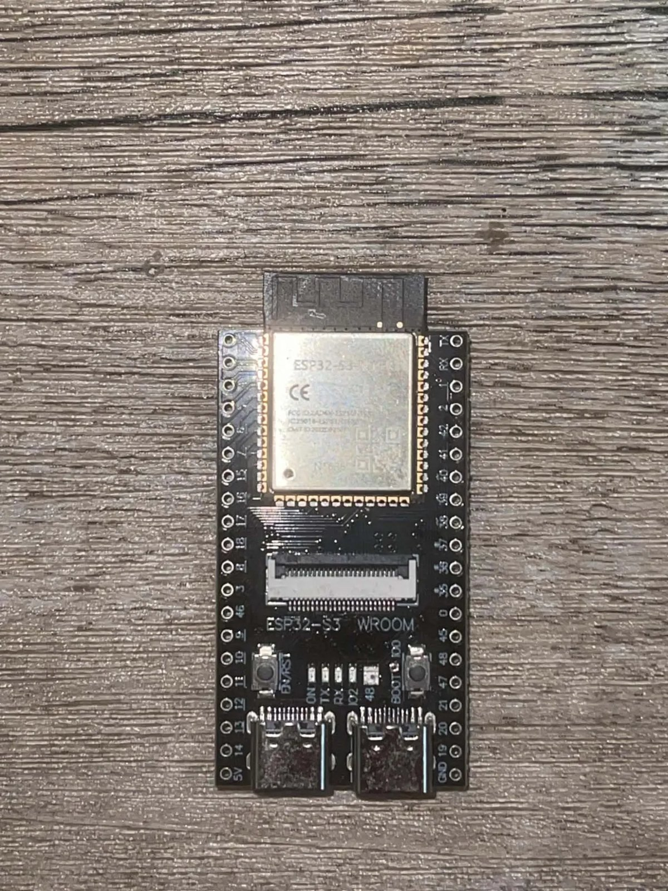
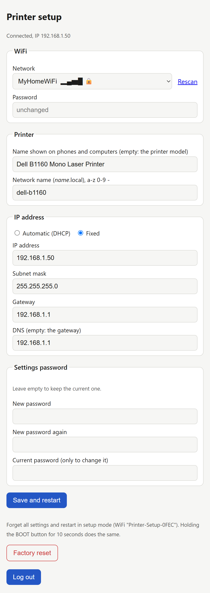
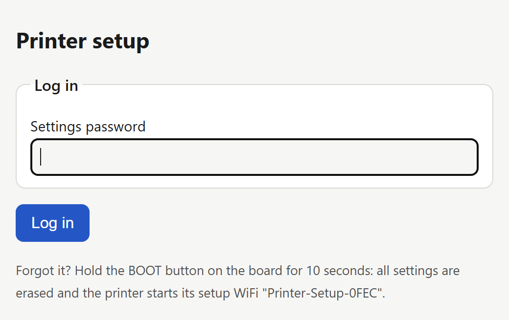
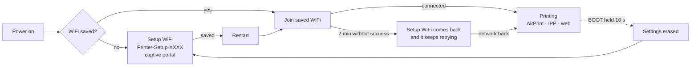

<div align="center">

# ESP32 USB → AirPrint

**Turn a USB-only printer into a wireless AirPrint / IPP Everywhere printer with a $10 ESP32-S3 board.**
No computer, no CUPS server, no drivers on your phone.

[](LICENSE)


**English** · [Tiếng Việt](README.vi.md) · [Français](README.fr.md)

[Features](#features) · [Supported printers](#supported-printers) · [Quick start](#quick-start) · [Setup page](#the-setup-page) · [Replacing a CUPS server](#replacing-a-cups-server) · [Troubleshooting](#troubleshooting)



</div>

> [!NOTE]
> This is a fork of [ngxson/esp32-usb-to-airprint](https://github.com/ngxson/esp32-usb-to-airprint) (Canon PIXMA printers and scanners). It adds a driver for **Samsung / Dell SPL laser printers (QPDL v3)**, a **web setup page with a captive portal** so no rebuild is needed to change WiFi, and support for **replacing an existing CUPS print server** without touching the clients.

## Features

- **Print** from iPhone, iPad and Mac (AirPrint), Android (Mopria), Windows and Linux (IPP Everywhere). No app, no driver.
- **Scan** (Canon all-in-ones) from any browser, from Image Capture / Preview on a Mac, or with the button on the board.
- **Setup from your phone.** A fresh board starts its own WiFi `Printer-Setup-XXXX`; join it and the setup page opens by itself. Pick your network from the list, done.
- **Web setup page** (`http://<name>.local/setup`): WiFi, printer name, network name, **DHCP or fixed IP**, settings password, factory reset.
- **Never locked out:** the setup WiFi comes back on its own if the saved network is out of reach for 2 minutes, and holding **BOOT for 10 s** erases all settings.
- **Drop-in CUPS replacement:** answers on `/ipp/print` and on CUPS-style `/printers/<queue>` URLs, so clients set up against an old print server keep working once the board takes its IP.
- **A web app** on your phone or computer: print PDFs and pictures, scan, keep the files in the browser, and put pages together (rotate, crop, ID card copies) into a PDF.

## Supported printers

| Family | Models | Status | Scan |
|---|---|---|---|
| **Samsung / Dell SPL (QPDL v3)** | **Dell B1160** | 🟢 tested: A4 1200 dpi, AirPrint from iPhone | no scanner |
| Samsung / Dell SPL (QPDL v3) | Samsung ML-2160 / ML-2165 / ML-2168, Dell B1160w (USB) | 🟡 same language, not tested yet | – |
| Canon PIXMA | MG2550S | 🟢 tested (upstream) | yes |
| Canon PIXMA | MG2400, MG2500, MG2900, MG3000, E460/E470, E3100, TS3100, MP230, MP250–MP288, MP490–MP499, MX340–MX428, iP2700, iP2800, P200 | 🟡 expected to work (upstream) | most |

- 🟢 validated on a real printer · 🟡 expected to work, not tested on real hardware yet

The firmware recognises the printer when it is plugged in (USB ids, then the IEEE 1284 model). Got another SPL laser (`MODE:SPL3` in its 1284 ID)? It probably needs only its USB ids in [`samsung_qpdl.c`](components/printers/samsung_qpdl.c) — please open an issue with a test print.

### Dell B1160 / SPL driver at a glance

| | |
|---|---|
| Resolution | 1200 × 1200 dpi, 1 bit, ordered dither for greys |
| Paper sizes | A4, A5, A6, Letter, Legal, Executive, Folio, Oficio, Statement, B5 (JIS / ISO), Index card 3×5", envelopes #10, DL, C5, C6, Monarch |
| Orientation | portrait and landscape: the phone or computer turns a landscape page into the raster before sending, the printer only receives the image |
| Speed | an A4 page is rendered in ~4–9 s and sent to the printer in one go (≈1 s over USB) |
| Margins | 4.4 mm unprintable border (the printer's own); placement checked with a ruler on a calibration page |

## What you need

- An **ESP32-S3 dev board with two USB-C ports** and PSRAM, e.g. *ESP32-S3-DevKitC-1 N16R8* clones (≈ $10):
  - the port marked **COM** (USB-UART chip) is for flashing and power,
  - the port marked **USB** (native USB, GPIO19/20) goes to the printer.
- A USB-C to USB-B cable (or an OTG adapter + your printer cable).


> [!TIP]
> Some boards only send 5 V to the **USB** port after you bridge the **USB-OTG** solder pads on the back. The printer needs that 5 V to notice the cable, even though it does not draw power from it.

Optional: an SSD1315 OLED screen and extra buttons, see [below](#adding-an-oled-screen-and-buttons).

## Quick start

### 1. Flash the firmware

With [PlatformIO](https://platformio.org/install/cli) and the board's **COM** port connected to your computer:

```bash
git clone https://github.com/ngojclee/esp32-usb-to-airprint
cd esp32-usb-to-airprint
pio run -e esp32s3 -t upload
```

The first build creates `.env` from [`.env.example`](.env.example). You can leave it as it is: WiFi is set up from your phone in the next step. (Putting `WIFI_SSID` / `WIFI_PASSWORD` there still works, as the default for a fresh board — but never share a firmware built that way.)

### 2. Connect the printer

Plug the printer into the board's **USB** port and power the board from its **COM** port (any 5 V phone charger).

### 3. Join the setup WiFi

A board with no WiFi configured starts an open WiFi named **`Printer-Setup-XXXX`**. Join it from your phone: the setup page opens on its own (if it doesn't, open `http://192.168.4.1/setup`).



Pick your network from the list, type its password, and press **Save and restart**. The board joins your WiFi and the setup WiFi goes away.

Optionally set:
- the **printer name** your phone shows (empty = the printer's model),
- the **network name**: the board answers at `http://<name>.local/`,
- a **fixed IP** instead of DHCP,
- a **settings password** for this page.

### 4. Print

- **iPhone / iPad:** Share → Print → pick the printer.
- **Mac:** System Settings → Printers & Scanners → Add → it is listed (AirPrint).
- **Android:** the built-in Default Print Service / Mopria finds it.
- **Windows 10/11:** Settings → Printers → Add device; or *Add manually* → *Select a shared printer by name* → `http://<name>.local:631/ipp/print`.
- **Linux:** it shows up as an IPP Everywhere printer (driverless).
- **The BOOT button** prints a test page (on a printer without a scanner), hold 2 s to cancel a job.

<br clear="right">

## The setup page

`http://<name>.local/setup` or `http://<IP>/setup`, from any device on your network.



| You want to… | Do this |
|---|---|
| Change WiFi | pick another network (or *Other network…*), type its password, save |
| Keep the board at the same address | *IP address → Fixed*, fill IP, mask, gateway |
| Protect the page | set a **settings password**: the page then asks for it once, and keeps you logged in for 30 minutes of use. Changing the password asks for the current one. |
| Start over | **Factory reset** on the page, or hold **BOOT for 10 s** |
| You forgot the password | hold **BOOT for 10 s**: everything is erased and the board starts `Printer-Setup-XXXX` again |

How the board finds a network:



> [!IMPORTANT]
> The page is plain HTTP, meant for your home or office network. Set a settings password if other people use the same network.

<br clear="right">

## Replacing a CUPS server

The board can take the place of a Linux box running CUPS for this printer, without reconfiguring the clients:

1. Stop CUPS on the old server and give that server another IP.
2. On the board's setup page: *IP address → Fixed*, enter the old server's IP.
3. Clients that print to `http(s)://<old IP>:631/printers/<queue name>` now reach the board (any queue name is accepted). iPhones and Macs find it by themselves.

If a client used to send PDF to CUPS, remove and re-add the printer there choosing *AirPrint* / *IPP Everywhere*: the board takes raster (URF / PWG), which every modern OS sends to such a printer.

## Troubleshooting

| Symptom | Likely cause / fix |
|---|---|
| The printer is not found by phones | phone and board on different networks or VLANs (mDNS does not cross routers); use the IP, or enable an mDNS reflector |
| `Printer-Setup-XXXX` keeps appearing | the saved WiFi is out of reach or its password is wrong; join the setup WiFi and fix it. 2.4 GHz networks only |
| Laser prints a page saying **Incomplete Session by time out** | report it with the serial log: the stream stopped mid-page |
| Nothing at all when the printer is plugged in | the **USB** port gives no 5 V: bridge the *USB-OTG* pads, or use a powered hub |
| Wrong paper size chosen | the board picks the closest supported size to the page sent; set the paper size in the print dialog |

The serial log (COM port, 115200 baud, `pio run -t monitor`) shows every job with timings, e.g. `page done: 109 bands, render 4050 ms, send 306 ms`.

## Adding an OLED screen and buttons

Optional. An SSD1315 OLED screen:

| OLED | ESP32-S3 |
|---|---|
| VCC | 3V3 |
| GND | GND |
| SCL | GPIO41 |
| SDA | GPIO42 |

Connect it before powering on: the board only looks for it at startup.


For buttons, wire each one between a pin and GND:

| Button | ESP32-S3 | Action |
|---|---|---|
| 1 | GPIO4 | Same as BOOT (scan, test page, cancel; 10 s: factory reset) |
| 2 | GPIO5 | Not assigned: add your own in `on_user_button()` (`src/main.c`) |

While the screen is off, a press only wakes it up.

## Development

Set `MODE=dev` and flash: print jobs are processed but not printed, and scans show a built-in test page.

On the computer, without the board: `make -C host && cd host && ./airprint_host`, then open http://localhost:8631/ (an emulated printer and scanner). To work on the web app with live reloading: `cd web && npm run dev`.

The SPL driver has its own host checks: `host/qpdl_selftest.c` encodes a page, [`tools/qpdl_decode.py`](tools/qpdl_decode.py) decodes the printer stream and compares it pixel by pixel. The format is described in [docs/samsung-qpdl.md](docs/samsung-qpdl.md).

Technical details are in [AGENTS.md](AGENTS.md).

## Adding a printer

Each printer model is a driver in `components/printers/`, listed in `printers.c`; the firmware picks the one of the printer that is plugged in. A Canon PIXMA whose stream is close to the MG2500's is one line in `canon_pixma.c`; another Samsung/Dell SPL laser is likely a copy of the `dell_b1160_driver` entry with its USB ids; anything else is a new file in the same folder. Every driver must be tested on the real printer.

## Credits & license

MIT, see [LICENSE](LICENSE).

- Original firmware, Canon drivers, scanner and web app: [ngxson/esp32-usb-to-airprint](https://github.com/ngxson/esp32-usb-to-airprint).
- The Canon protocols follow [Gutenprint](https://gimp-print.sourceforge.io/) and [SANE](http://www.sane-project.org/)'s pixma backend.
- The SPL / QPDL v3 stream layout was worked out from captures of the printer's own drivers, with the format notes of the [SpliX](https://github.com/OpenPrinting/splix) project (GPL-2.0) as a reference. No SpliX code is used: the encoder is an independent implementation.
- The JPEG encoder's DCT is a translation of libjpeg's `jfdctint.c`: this software is based in part on the work of the Independent JPEG Group. The web UI bundles [Svelte](https://svelte.dev/) (MIT) and [pdf.js](https://mozilla.github.io/pdf.js/) (Apache-2.0).
