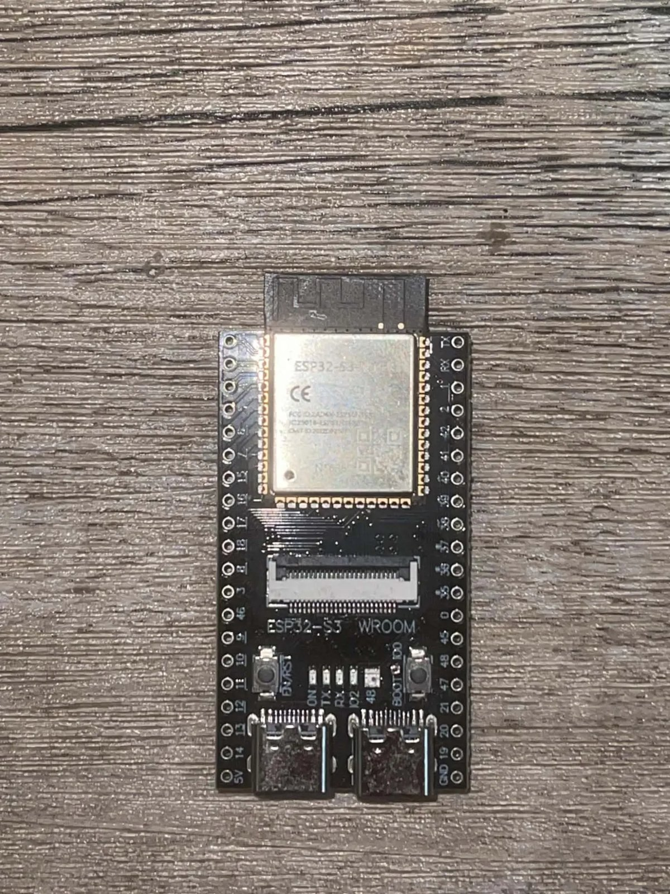
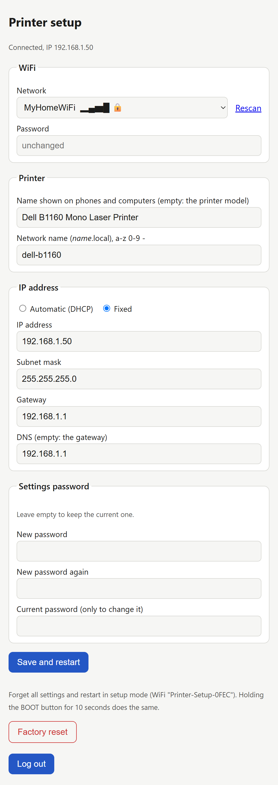
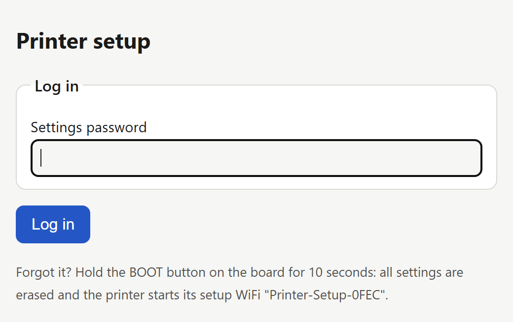
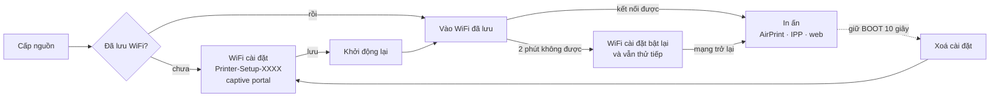

<div align="center">

# ESP32 USB → AirPrint

**Biến máy in chỉ có cổng USB thành máy in không dây AirPrint / IPP Everywhere, chỉ với một board ESP32-S3 giá khoảng 10 USD.**
Không cần máy tính, không cần server CUPS, không cần cài driver trên điện thoại.

[English](README.md) · **Tiếng Việt** · [Français](README.fr.md)

[](LICENSE)




</div>

> [!NOTE]
> Đây là bản fork của [ngxson/esp32-usb-to-airprint](https://github.com/ngxson/esp32-usb-to-airprint) (máy in và máy scan Canon PIXMA). Bản này thêm **driver cho máy in laser Samsung / Dell SPL (QPDL v3)**, **trang cài đặt trên web kèm captive portal** (đổi WiFi không cần build lại firmware) và khả năng **thay thế server CUPS cũ** mà các máy khách không phải cài lại.

## Tính năng

- **In** từ iPhone, iPad, Mac (AirPrint), Android (Mopria), Windows, Linux (IPP Everywhere). Không app, không driver.
- **Scan** (máy Canon đa năng) từ trình duyệt, từ Image Capture / Preview trên Mac, hoặc bằng nút trên board.
- **Cài đặt ngay từ điện thoại.** Board mới tự phát WiFi `Printer-Setup-XXXX`; kết nối vào là trang cài đặt tự mở. Chọn WiFi trong danh sách là xong.
- **Trang cài đặt web** (`http://<tên>.local/setup`): WiFi, tên máy in, tên mạng, **DHCP hoặc IP tĩnh**, mật khẩu trang cài đặt, khôi phục cài đặt gốc.
- **Không bao giờ bị khoá ngoài:** WiFi cài đặt tự bật lại nếu WiFi đã lưu mất quá 2 phút, và **giữ nút BOOT 10 giây** sẽ xoá toàn bộ cài đặt.
- **Thay thế CUPS tại chỗ:** board trả lời ở `/ipp/print` và cả đường dẫn kiểu CUPS `/printers/<hàng in>`, nên máy khách đã cài sẵn với server cũ vẫn in được khi board nhận IP của server đó.
- **Web app** trên điện thoại/máy tính: in PDF và ảnh, scan, lưu file trong trình duyệt, ghép trang (xoay, cắt, sao chụp CCCD) thành PDF.

## Máy in được hỗ trợ

| Dòng máy | Model | Trạng thái | Scan |
|---|---|---|---|
| **Samsung / Dell SPL (QPDL v3)** | **Dell B1160** | 🟢 đã thử: A4 1200 dpi, AirPrint từ iPhone | không có scanner |
| Samsung / Dell SPL (QPDL v3) | Samsung ML-2160 / ML-2165 / ML-2168, Dell B1160w (USB) | 🟡 cùng ngôn ngữ in, chưa thử | – |
| Canon PIXMA | MG2550S | 🟢 đã thử (bản gốc) | có |
| Canon PIXMA | MG2400, MG2500, MG2900, MG3000, E460/E470, E3100, TS3100, MP230, MP250–MP288, MP490–MP499, MX340–MX428, iP2700, iP2800, P200 | 🟡 dự kiến chạy được (bản gốc) | đa số có |

- 🟢 đã kiểm chứng trên máy thật · 🟡 dự kiến chạy được, chưa thử trên máy thật

Firmware tự nhận máy in khi cắm vào (mã USB, rồi model theo IEEE 1284). Máy laser SPL khác (`MODE:SPL3` trong ID 1284)? Rất có thể chỉ cần thêm mã USB vào [`samsung_qpdl.c`](components/printers/samsung_qpdl.c) — hãy mở issue kèm trang in thử.

### Driver Dell B1160 / SPL

| | |
|---|---|
| Độ phân giải | 1200 × 1200 dpi, 1 bit, dither có thứ tự cho vùng xám |
| Khổ giấy | A4, A5, A6, Letter, Legal, Executive, Folio, Oficio, Statement, B5 (JIS / ISO), thẻ 3×5", phong bì #10, DL, C5, C6, Monarch |
| Hướng giấy | dọc / ngang: điện thoại và máy tính tự xoay trang ngang thành ảnh raster trước khi gửi, máy in chỉ nhận ảnh |
| Tốc độ | một trang A4 xử lý khoảng 4–9 giây rồi gửi sang máy in một lần (khoảng 1 giây qua USB) |
| Lề | viền không in 4,4 mm (của chính máy in); vị trí được kiểm bằng thước trên trang hiệu chuẩn |

## Cần chuẩn bị

- Board **ESP32-S3 có 2 cổng USB-C** và PSRAM, ví dụ các bản nhái *ESP32-S3-DevKitC-1 N16R8* (khoảng 10 USD):
  - cổng **COM** (chip USB-UART): nạp firmware và cấp nguồn,
  - cổng **USB** (USB native, GPIO19/20): nối với máy in.
- Cáp USB-C → USB-B (hoặc đầu OTG + cáp máy in sẵn có).


> [!TIP]
> Một số board chỉ có 5 V ở cổng **USB** sau khi hàn nối 2 chấm **USB-OTG** ở mặt sau. Máy in cần 5 V này để nhận biết dây cắm, dù nó không lấy điện từ đó.

Tuỳ chọn: màn hình OLED SSD1315 và thêm nút bấm, xem [phần dưới](#màn-hình-oled-và-nút-bấm).

## Bắt đầu nhanh

### 1. Nạp firmware (làm 1 lần)

Cài [PlatformIO](https://platformio.org/install/cli), cắm cổng **COM** của board vào máy tính:

```bash
git clone https://github.com/ngojclee/esp32-usb-to-airprint
cd esp32-usb-to-airprint
pio run -e esp32s3 -t upload
```

Lần build đầu tạo file `.env` từ [`.env.example`](.env.example); cứ để nguyên: WiFi được cài từ điện thoại ở bước sau. (Điền `WIFI_SSID` / `WIFI_PASSWORD` vào đó vẫn được, làm giá trị mặc định cho board mới, nhưng đừng chia sẻ firmware build kiểu đó.)

### 2. Nối máy in

Cắm máy in vào cổng **USB** của board, cắm sạc 5 V vào cổng **COM**.

### 3. Vào WiFi cài đặt

Board chưa có WiFi sẽ phát WiFi **`Printer-Setup-XXXX`** (không mật khẩu). Kết nối từ điện thoại: trang cài đặt tự mở (nếu không, vào `http://192.168.4.1/setup`).



Chọn WiFi nhà trong danh sách (board tự quét, có vạch sóng và biểu tượng khoá), nhập mật khẩu, bấm **Save and restart**. Board vào WiFi nhà và **WiFi cài đặt tắt đi**.

Có thể đặt thêm:
- **tên máy in** hiện trên điện thoại (để trống = tên model),
- **tên mạng**: board trả lời ở `http://<tên>.local/`,
- **IP tĩnh** thay cho DHCP,
- **mật khẩu trang cài đặt**.

### 4. In

- **iPhone / iPad:** Chia sẻ → In → chọn máy in.
- **Mac:** Cài đặt hệ thống → Máy in & Máy quét → Thêm → máy in có trong danh sách (AirPrint).
- **Android:** Dịch vụ in mặc định / Mopria tự tìm thấy.
- **Windows 10/11:** Cài đặt → Máy in → Thêm thiết bị; hoặc *Thêm thủ công* → *Chọn máy in dùng chung theo tên* → `http://<tên>.local:631/ipp/print`.
- **Linux:** tự nhận là máy in IPP Everywhere (không cần driver).
- **Nút BOOT:** in trang test (máy in không có scanner), giữ 2 giây để huỷ job.

<br clear="right">

## Trang cài đặt

`http://<tên>.local/setup` hoặc `http://<IP>/setup`, từ thiết bị bất kỳ trong mạng.



| Muốn | Làm thế này |
|---|---|
| Đổi WiFi | chọn mạng khác (hoặc *Other network…*), nhập mật khẩu, lưu |
| Giữ board ở một địa chỉ cố định | *IP address → Fixed*, điền IP, mask, gateway |
| Bảo vệ trang | đặt **mật khẩu trang cài đặt**: trang sẽ hỏi một lần, rồi giữ đăng nhập 30 phút kể từ lần thao tác cuối. Đổi mật khẩu cần nhập mật khẩu hiện tại. |
| Cài lại từ đầu | **Factory reset** trên trang, hoặc giữ **BOOT 10 giây** |
| Quên mật khẩu | giữ **BOOT 10 giây**: xoá toàn bộ cài đặt, board phát lại `Printer-Setup-XXXX` |

Cách board tìm mạng:



Sau khi cài xong, WiFi `Printer-Setup` **không còn** — chỉ vào bằng IP hoặc tên `.local`. In ấn thì không cần vào đâu: iPhone/Mac/Android tự thấy máy in khi cùng mạng.

> [!IMPORTANT]
> Trang chạy HTTP thường, dành cho mạng nhà hoặc văn phòng. Hãy đặt mật khẩu nếu có người lạ dùng chung mạng.

Các thao tác với nút BOOT:

| Bấm | Tác dụng |
|---|---|
| 1 lần | in trang test (máy không có scanner) / scan (máy Canon có scanner) |
| 2 lần | in trang test |
| giữ 2 giây | huỷ job đang in |
| **giữ 10 giây** | **xoá cài đặt, về chế độ cài đặt** |

<br clear="right">

## Thay thế server CUPS cũ

Board có thể thay một máy Linux chạy CUPS cho máy in này mà không phải cấu hình lại các máy khách:

1. Tắt CUPS trên máy cũ và đổi IP máy cũ sang IP khác.
2. Trên trang cài đặt của board: *IP address → Fixed*, nhập IP cũ của server.
3. Máy nào in tới `http(s)://<IP cũ>:631/printers/<tên hàng in>` giờ sẽ vào board (board nhận mọi tên hàng in). iPhone và Mac tự tìm thấy.

Máy nào trước đây gửi PDF thẳng cho CUPS thì xoá máy in đó đi và thêm lại kiểu *AirPrint* / *IPP Everywhere*: board nhận ảnh raster (URF / PWG), thứ mà mọi hệ điều hành hiện đại đều gửi cho loại máy in này.

## Gặp sự cố

| Hiện tượng | Nguyên nhân / cách xử lý |
|---|---|
| Điện thoại không thấy máy in | điện thoại và board khác mạng hoặc khác VLAN (mDNS không đi qua router); dùng IP, hoặc bật mDNS reflector |
| `Printer-Setup-XXXX` cứ hiện lại | WiFi đã lưu ngoài tầm hoặc sai mật khẩu; vào WiFi cài đặt để sửa. Chỉ hỗ trợ WiFi 2.4 GHz |
| Máy laser in ra trang **Incomplete Session by time out** | gửi log serial kèm ảnh trang lỗi: luồng dữ liệu bị dừng giữa trang |
| Cắm máy in không có phản ứng gì | cổng **USB** không có 5 V: hàn cầu *USB-OTG* hoặc dùng hub có nguồn |
| Chọn sai khổ giấy | board chọn khổ gần nhất với trang được gửi; hãy chọn khổ giấy trong hộp thoại in |

Log serial (cổng COM, 115200 baud, `pio run -t monitor`) ghi từng job kèm thời gian, ví dụ `page done: 109 bands, render 4050 ms, send 306 ms`.

## Màn hình OLED và nút bấm

Tuỳ chọn. Màn hình OLED SSD1315:

| OLED | ESP32-S3 |
|---|---|
| VCC | 3V3 |
| GND | GND |
| SCL | GPIO41 |
| SDA | GPIO42 |

Nối trước khi cấp nguồn: board chỉ tìm màn hình lúc khởi động.


Nút bấm: nối mỗi nút giữa một chân và GND:

| Nút | ESP32-S3 | Tác dụng |
|---|---|---|
| 1 | GPIO4 | Giống BOOT (scan, trang test, huỷ; giữ 10 giây: khôi phục cài đặt gốc) |
| 2 | GPIO5 | Chưa gán: tự thêm chức năng trong `on_user_button()` (`src/main.c`) |

Khi màn hình đang tắt, bấm nút chỉ để bật màn hình.

## Phát triển

Đặt `MODE=dev` rồi nạp: job in được xử lý nhưng không in, scan cho ra trang test dựng sẵn.

Trên máy tính, không cần board: `make -C host && cd host && ./airprint_host`, rồi mở http://localhost:8631/ (máy in và scanner giả lập).

Driver SPL có bộ kiểm tra riêng trên máy tính: `host/qpdl_selftest.c` mã hoá một trang, [`tools/qpdl_decode.py`](tools/qpdl_decode.py) giải mã luồng in và so từng điểm ảnh. Định dạng được mô tả ở [docs/samsung-qpdl.md](docs/samsung-qpdl.md) (tiếng Anh). Chi tiết kỹ thuật khác ở [AGENTS.md](AGENTS.md).

## Thêm máy in

Mỗi model là một driver trong `components/printers/`, khai báo ở `printers.c`; firmware chọn driver theo máy in đang cắm. Một máy Samsung/Dell SPL khác nhiều khả năng chỉ cần sao chép mục `dell_b1160_driver` và đổi mã USB; máy khác nữa thì là một file mới. Mọi driver đều phải thử trên máy in thật.

## Ghi công & giấy phép

MIT, xem [LICENSE](LICENSE).

- Firmware gốc, driver Canon, scanner và web app: [ngxson/esp32-usb-to-airprint](https://github.com/ngxson/esp32-usb-to-airprint).
- Giao thức Canon theo [Gutenprint](https://gimp-print.sourceforge.io/) và backend pixma của [SANE](http://www.sane-project.org/).
- Cấu trúc luồng in SPL / QPDL v3 được tìm hiểu từ các bản ghi của driver chính hãng, tham khảo ghi chú định dạng của dự án [SpliX](https://github.com/OpenPrinting/splix) (GPL-2.0). Không dùng mã nguồn SpliX: encoder là bản cài đặt độc lập.
- DCT của bộ mã hoá JPEG là bản dịch của `jfdctint.c` trong libjpeg: phần mềm này dựa một phần trên công trình của Independent JPEG Group. Web UI dùng [Svelte](https://svelte.dev/) (MIT) và [pdf.js](https://mozilla.github.io/pdf.js/) (Apache-2.0).
